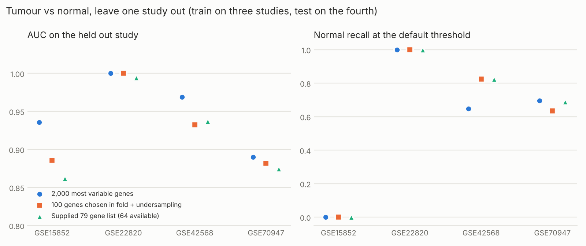
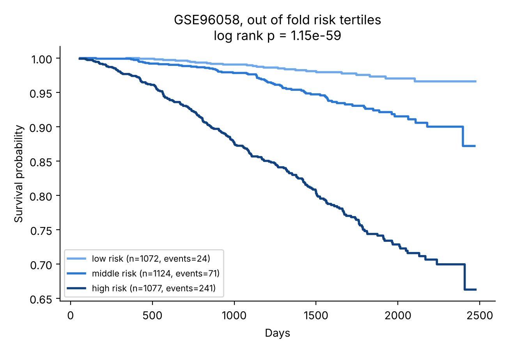

# Breast Cancer Gene Expression: Machine Learning You Can Trust

**Classifying breast tumour tissue and predicting survival from gene expression, across five public studies and more than 4,000 patients, with an evaluation built to show how far each result can be trusted.**

  

This repository contains two things:

1. **A complete analysis** of public breast cancer expression data: tumour versus normal tissue, overall survival and molecular subtype, with every number reported alongside its uncertainty.
2. **[exprkit](exprkit)**, the open source toolkit built to run that analysis and reusable for any expression study. It covers data preparation from GEO, gene selection, classification, survival and regression models, and prediction on new samples.

> Research software. Not a medical device; not for clinical decisions.

---

## Why this matters

Breast cancer is the most commonly diagnosed cancer in women worldwide. In 2022 it accounted for an estimated **2.3 million new cases and 670,000 deaths**, and both numbers are projected to rise sharply by 2050 ([Kim et al. 2025, *Nature Medicine*](https://www.healthday.com/healthpro-news/cancer/23-million-new-female-breast-cancer-cases-seen-globally-in-2022)). In Canada, about **32,400 women** are projected to be diagnosed in 2026, a quarter of all cancers in women ([Canadian Cancer Society](https://cancer.ca/en/cancer-information/cancer-types/breast/statistics)).

Gene expression is already part of breast cancer care. Multigene tests such as the 21-gene recurrence score ([Paik et al. 2004](https://doi.org/10.1056/NEJMoa041588)) and PAM50 subtyping guide treatment decisions. But the field has a well documented reproducibility problem:

- When the largest early microarray studies of cancer prognosis were re-analysed with repeated random validation, five of the seven did not classify patients better than chance ([Michiels, Koscielny and Hill 2005, *Lancet*](https://doi.org/10.1016/S0140-6736(05)17866-0)).
- Choosing genes on all samples before testing makes results look better than they are ([Ambroise and McLachlan 2002, *PNAS*](https://pmc.ncbi.nlm.nih.gov/articles/PMC124442)).
- Pooling studies in which a class comes from only one study can create differences that are not there ([Nygaard, Rødland and Hovig 2016, *Biostatistics*](https://www.ncbi.nlm.nih.gov/pmc/articles/PMC4679072/)).

**This project's contribution** is an analysis, and a tool, in which those failure modes are tested for explicitly rather than assumed away. A strong number here has survived the checks, and a weak one is reported as weak.

---

## Key findings

All results come from public GEO data. Intervals are 95%. Full details are in the [case study](exprkit/docs/case_study_breast_cancer.md).

### 1. Tumour versus normal tissue is easy within one study, and harder across studies

| Setting | Data | Result |
|---|---|---|
| Within one study | GSE22820: 176 tumours, 10 normals | AUC 1.00 in all 20 repeats of nested 5 fold cross validation (permutation p = 0.005) |
| Across studies, each study held out in turn | GSE22820, GSE15852, GSE42568, GSE70947: 218 normals, 471 tumours | AUC 0.89 to 1.00 on the unseen study |
| Pooled cross validation, for contrast | same four studies | AUC 0.985 |

A perfect score with 10 normal samples still leaves real uncertainty: the exact 95% interval for normal recall is 0.69 to 1.00. Across studies, the model still **ranks** tumours above normals, but its **decision threshold does not transfer**: in one held out study, all 43 normal samples were called tumour. A model moved to a new cohort needs recalibration on labelled samples from that cohort. Pooled cross validation hides this.

<p align="center"></p>

### 2. A near perfect score that came from the study, not the biology

A pooled dataset whose 10 normal samples all came from one study scored **AUC 0.996**. Two checks show where that score came from:

- **Recall by study.** Only 39.5% of tumours from the normals' study were called tumour, against 99.95% from the other study.
- **A held out test.** A model trained on "normals from study A" against "tumours from study B" was then shown 176 tumours from study A that it had never seen. It called **173 of them normal**.

The model had learned to recognise the study. The two studies can be told apart with AUC 1.00, and they remain separable even after per sample rank normalisation.

### 3. Gene expression adds modestly to clinical factors for survival

| Model (GSE96058: 3,273 patients, 336 deaths) | Harrell's C | Gain over clinical factors, same folds |
|---|---|---|
| Age alone | 0.73 | |
| Age, tumour size, node status, grade, ER, HER2 | 0.76 (0.74 to 0.79) | reference |
| + 1,000 most variable genes (elastic net Cox) | 0.78 | +0.021 (+0.002 to +0.039) |
| **+ 50 genes chosen inside each training fold** | **0.79** | **+0.024 (+0.009 to +0.039), p = 0.003** |
| + a 79 gene list chosen earlier on overlapping data | 0.78 | +0.015 (−0.000 to +0.030), not significant |

The comparison that counts is against clinical factors, not against chance: age alone reaches 0.73. The most trustworthy gene model is the one whose genes were chosen inside the training folds only.

<p align="center"></p>

### 4. Molecular subtype is recoverable from expression

PAM50 subtype (five classes) is predicted with a macro AUC of **0.977** and accuracy of 0.85. Most errors are LumA versus LumB, which lie on a continuum of proliferation.

### 5. Data checks that changed conclusions

| Check | What it found |
|---|---|
| Value scale | One study was distributed as unlogged ratios (0.01 to 20,566), so it needed log2 before modelling |
| Copied samples | A training table's 2,868 normal rows were 8 distinct profiles copied about 356 times each |
| Imputed covariates | For 734 patients, tumour size was exactly 12.50 + 0.118 × age: filled in from age, so treated as missing |
| Labels | One study calls its normal samples "tissue adjacent to tumor"; a naive text rule would have labelled them tumour, and the tool's exactly-one-rule check stops the run |
| Gene selection | With 2,000 genes of pure noise, choosing genes before cross validation gives AUC 0.94; choosing inside each fold gives 0.52 |

---

## Approach and expertise demonstrated

| Area | What was done |
|---|---|
| **Data engineering** | Integrated five GEO studies from four platforms (two Agilent, two Affymetrix) and RNA sequencing. Mapped probes to genes with each platform's annotation, linked metadata by accession or sample title, matched genes by exact symbol, and checked every label and count against the published record |
| **Statistical learning** | Nested, repeated, patient-grouped cross validation; leave one study out validation; penalised logistic and Cox models; a neural Cox model (DeepSurv style) with a tested loss; undersampling ensembles; stability selection |
| **Uncertainty and inference** | Corrected resampled t intervals for repeated cross validation (Nadeau and Bengio 2003); stratified bootstrap; exact Clopper-Pearson intervals; label permutation tests; paired comparisons with clinical baselines |
| **Study design** | Detection of leakage, confounding, batch effects, duplicated samples, imputed covariates and mislabelled classes, each with a test that demonstrates it |
| **Software engineering** | An installable Python package with a command line interface, YAML configuration, 51 tests with known answers, continuous integration, and documentation for users and contributors |
| **Scientific communication** | A [case study](exprkit/docs/case_study_breast_cancer.md) that reports what the numbers do *and do not* support, and a [guide to 22 common pitfalls](exprkit/docs/pitfalls.md) |

## Repository structure

```
breast-cancer-gene-expression/
├── README.md               this overview
├── exprkit/                the toolkit (installable Python package)
│   ├── README.md           what the tool does, installation, quick start
│   ├── src/exprkit/        source code
│   ├── examples/           configs that reproduce every result above
│   ├── gene_lists/         gene lists produced or used, with provenance
│   ├── docs/               user guide, pitfalls guide, case study, figures
│   └── tests/              51 tests on simulated data with known answers
├── .github/workflows/      continuous integration
├── CITATION.cff            how to cite this work
└── LICENSE                 MIT
```

## Reproduce the results

```bash
git clone https://github.com/AdebayoAAdeniyi/breast-cancer-gene-expression.git
cd breast-cancer-gene-expression/exprkit
python -m venv .venv && source .venv/bin/activate
pip install -e ".[dev]"
pytest                                          # 51 tests, about 20 seconds
bash examples/breast_cancer/download_geo.sh     # public GEO files into data/raw
bash examples/breast_cancer/run.sh              # every analysis in the case study
```

Raw data and results are not stored in the repository; everything is rebuilt from the public sources below. See [exprkit/README.md](exprkit/README.md) for using the toolkit on your own data.

## Data sources

| Accession | Content | Used for |
|---|---|---|
| [GSE22820](https://www.ncbi.nlm.nih.gov/geo/query/acc.cgi?acc=GSE22820) | Agilent microarray: 176 primary breast cancers, 10 normal breast | Tumour vs normal |
| [GSE96058](https://www.ncbi.nlm.nih.gov/geo/query/acc.cgi?acc=GSE96058) | SCAN-B RNA sequencing: 3,273 breast cancers with clinical data and overall survival | Survival, PAM50 |
| [GSE15852](https://www.ncbi.nlm.nih.gov/geo/query/acc.cgi?acc=GSE15852) | Affymetrix U133A: 43 tumours with paired normal tissue | Tumour vs normal across studies |
| [GSE42568](https://www.ncbi.nlm.nih.gov/geo/query/acc.cgi?acc=GSE42568) | Affymetrix U133 Plus 2: 104 cancers, 17 normal breast | Tumour vs normal across studies |
| [GSE70947](https://www.ncbi.nlm.nih.gov/geo/query/acc.cgi?acc=GSE70947) | Agilent: 148 tumours with paired adjacent normal tissue | Tumour vs normal across studies |

## Limitations

- Survival is overall survival in a single cohort, validated internally only; deaths from other causes are included.
- "Normal" tissue differs between studies (normal breast versus tissue adjacent to a tumour).
- No external cohort has yet been used to validate the gene lists; results with lists chosen on these studies are optimistic by design, and this is stated wherever they appear.

## About the author

**Adebayo A. Adeniyi**
- B.Sc., M.Sc. and Ph.D. in chemistry, specialising in computational chemistry.
- About a decade as a university professor from 2007.
- Computing science at the University of Alberta, completed in May 2026.

This project began in CMPUT 606 (Bioinformatics, University of Alberta, Winter Term 2025). It was rebuilt into a validated, reusable toolkit, bringing together the modelling discipline of computational chemistry and modern machine learning practice.

## Citation and licence

Please cite this work using [CITATION.cff](CITATION.cff); GitHub shows a "Cite this repository" button. The code is released under the [MIT licence](LICENSE). Public datasets remain under their own terms and are not redistributed here.

## References

- Ambroise C, McLachlan GJ. Selection bias in gene extraction on the basis of microarray gene expression data. *PNAS* 2002;99:6562–6566.
- Harrell FE, Lee KL, Mark DB. Multivariable prognostic models. *Statistics in Medicine* 1996;15:361–387.
- Kim J, et al. Global patterns and trends in breast cancer incidence and mortality across 185 countries. *Nature Medicine* 2025.
- Meinshausen N, Bühlmann P. Stability selection. *Journal of the Royal Statistical Society B* 2010;72:417–473.
- Michiels S, Koscielny S, Hill C. Prediction of cancer outcome with microarrays: a multiple random validation strategy. *Lancet* 2005;365:488–492.
- Nadeau C, Bengio Y. Inference for the generalization error. *Machine Learning* 2003;52:239–281.
- Nygaard V, Rødland EA, Hovig E. Methods that remove batch effects while retaining group differences may lead to exaggerated confidence in downstream analyses. *Biostatistics* 2016;17:29–39.
- Ojala M, Garriga GC. Permutation tests for studying classifier performance. *JMLR* 2010;11:1833–1863.
- Paik S, et al. A multigene assay to predict recurrence of tamoxifen-treated, node-negative breast cancer. *NEJM* 2004;351:2817–2826.
